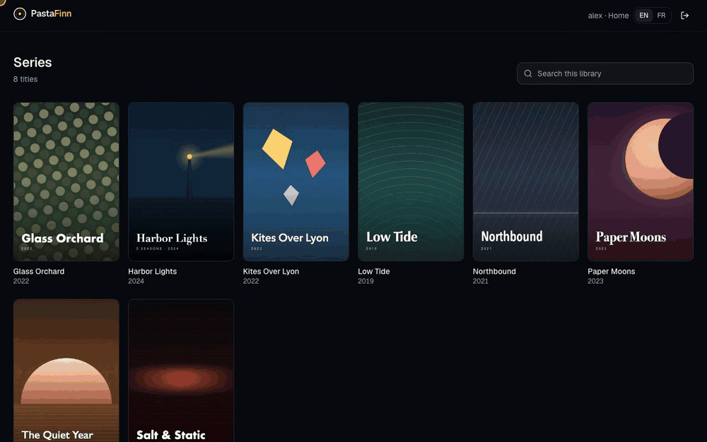
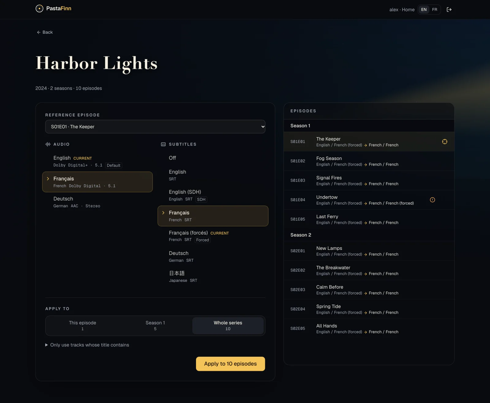
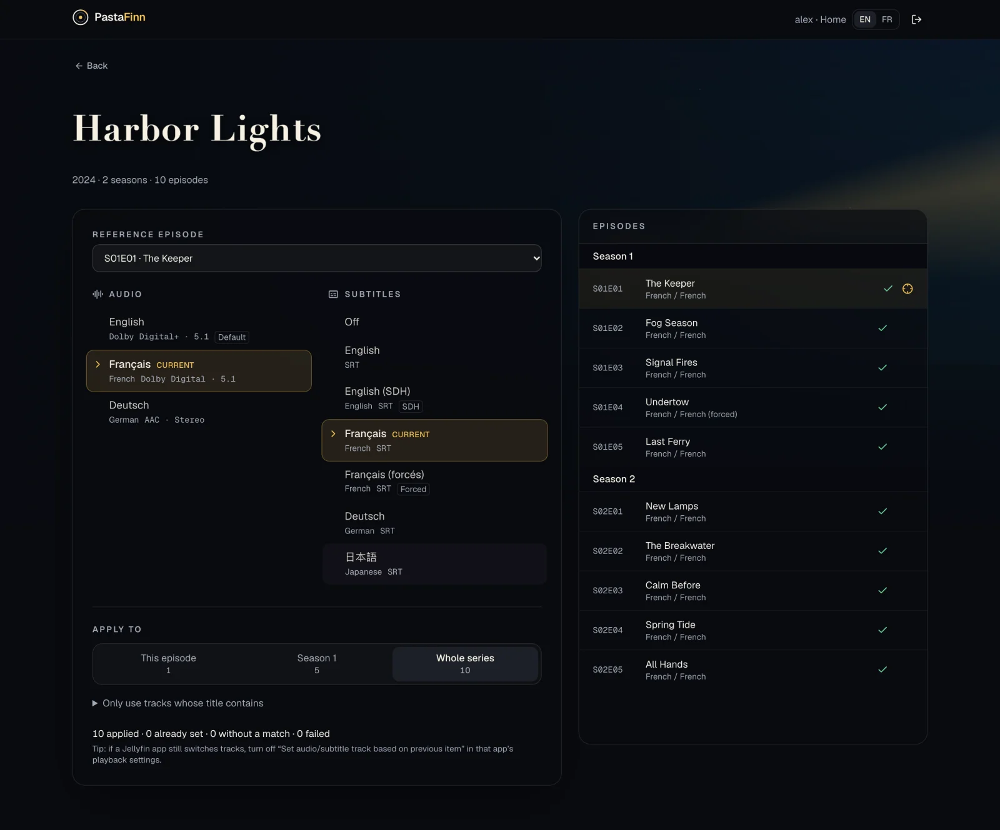
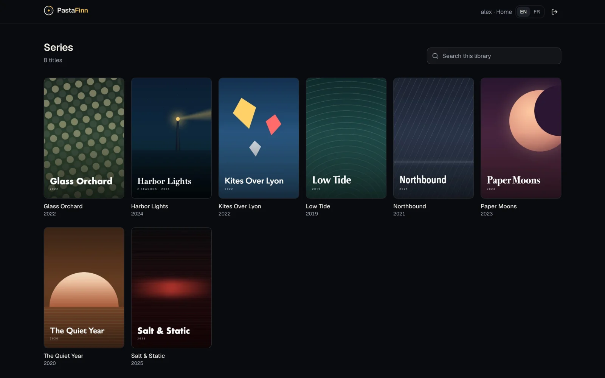
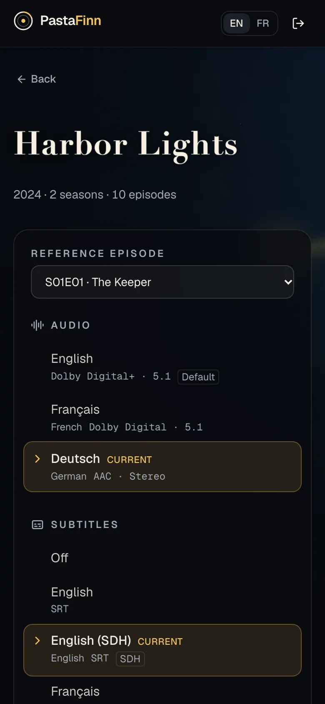
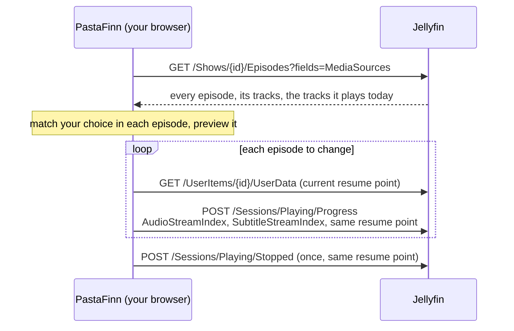

<p align="center">
  
</p>

<p align="center">
  <strong>Pick the audio and subtitles once. Apply them to the whole series.</strong><br>
  A small, private web app for <a href="https://jellyfin.org">Jellyfin</a>.
</p>

<p align="center">
  <a href="LICENSE"></a>
  
  
  
</p>

<p align="center">
  <a href="#quick-start">Quick start</a> ·
  <a href="#features">Features</a> ·
  <a href="#how-it-works">How it works</a> ·
  <a href="#faq">FAQ</a> ·
  <a href="#development">Development</a>
</p>

<p align="center">
  
</p>

## Why

You start a binge and the show plays in the wrong dub. Or with no subtitles. Or with "forced" subtitles that only cover the alien language. You fix it in the player, and the next episode starts with the wrong tracks again, sixty times over.

Jellyfin remembers your track choice **per episode**. PastaFinn lets you make that choice **once**, for an episode, a season or the whole series, and every Jellyfin app (web, TV, phone) then starts each episode with the right tracks.

## Features

- **The whole series in one click.** Apply to one episode, one season or every episode, movies too.
- **Smart matching.** Files differ from one episode to the next, so tracks are matched by title, language, codec and flags, not by position. Forced subtitles never stand in for full ones, and the reverse.
- **No surprises.** A preview lists what each episode will get _before_ you apply, flags the episodes with no matching track, and a summary tells you what happened.
- **Watch history untouched.** Watched state, play counts and resume points stay exactly as they were. This is covered by an end-to-end test against a real Jellyfin.
- **Private by design.** A static page: your browser talks to your Jellyfin server and nothing else. No backend, no account, no analytics.
- **Works the way you do.** Keyboard and screen-reader friendly, fine on a phone, English and French.
- **Settings check.** If your Jellyfin account is set to forget track choices, PastaFinn tells you and fixes it in one click.

## Screenshots

<table>
  <tr>
    <td width="50%"></td>
    <td width="50%"></td>
  </tr>
  <tr>
    <td align="center"><sub>Pick the tracks, see what each episode will get. S01E04 has no full French subtitles, and says so.</sub></td>
    <td align="center"><sub>Applied to the whole series, with a summary.</sub></td>
  </tr>
  <tr>
    <td width="50%"></td>
    <td width="50%" align="center"></td>
  </tr>
  <tr>
    <td align="center"><sub>Browse and search your libraries.</sub></td>
    <td align="center"><sub>Comfortable on a phone, from the couch.</sub></td>
  </tr>
</table>

<sub>The library in these screenshots is fictional and generated by <code>npm run screenshots</code>: every title and poster is made up.</sub>

## Quick start

PastaFinn is a static site. Host it next to your Jellyfin, open it, enter your server address and sign in with your Jellyfin account (or Quick Connect).

### Docker

```sh
docker build -t pastafinn https://github.com/florianchevallier/pastafinn.git
docker run -d --name pastafinn -p 8087:8080 --restart unless-stopped pastafinn
```

Open `http://<your-host>:8087`. The image is unprivileged nginx serving the built files on port 8080.

<details>
<summary>Docker Compose</summary>

```yaml
services:
  pastafinn:
    build: https://github.com/florianchevallier/pastafinn.git
    container_name: pastafinn
    ports:
      - "8087:8080"
    restart: unless-stopped
```

</details>

### Any web server

```sh
git clone https://github.com/florianchevallier/pastafinn.git && cd pastafinn
npm ci && npm run build
# serve dist/ from nginx, Caddy, Apache, a NAS… at any path
```

> [!IMPORTANT]
> Browsers block an **HTTPS** page from calling an **HTTP** server. If your Jellyfin is plain HTTP (for example `http://192.168.1.10:8096`), serve PastaFinn over HTTP too, or put both behind the same HTTPS reverse proxy. PastaFinn detects this case and explains it on the sign-in screen.

## How it works

Jellyfin has no API to set the default tracks of an episode. It does, however, remember the tracks a player reports while playing, and uses them the next time the episode starts (the _Remember audio/subtitle selections_ user settings). PastaFinn reports exactly that, one episode at a time:



|                     |                                                                                                                                                                                                                |
| ------------------- | -------------------------------------------------------------------------------------------------------------------------------------------------------------------------------------------------------------- |
| **Changes**         | The remembered audio and subtitle track of each episode, for your user only.                                                                                                                                   |
| **Does not change** | Watched state, play count, resume point, your media files, other users.                                                                                                                                        |
| **Side effect**     | Your dashboard's activity log shows one "finished playing" line per batch. On Jellyfin 12, an episode you are partway through gets its "last played" date refreshed, so it can move up in _Continue watching_. |

The resume point is read from the server right before each write, so an episode watched on another device while PastaFinn is open keeps its newer position. Episodes whose duration Jellyfin does not know yet are skipped, because Jellyfin would count any check-in on them as a full play.

## Compatibility

| Jellyfin | Status                                       |
| -------- | -------------------------------------------- |
| 12.x     | ✅ Tested on every commit (12.3, end-to-end) |
| 10.11    | ✅ Tested (10.11.0, end-to-end)              |
| 10.10    | Should work, not tested                      |
| older    | Not supported                                |

Any recent Chrome, Edge, Firefox or Safari, desktop or mobile.

## FAQ

<details>
<summary><b>A Jellyfin app still switches tracks on its own.</b></summary>

Some apps have a _Set audio track based on previous item_ / _Set subtitle track based on previous item_ option in their playback settings. It overrides the remembered tracks: turn it off.
</details>

<details>
<summary><b>"Could not reach the server", but Jellyfin is up.</b></summary>

Usually CORS, or mixed content. Jellyfin answers cross-origin requests out of the box, but some reverse proxies answer the browser's `OPTIONS` pre-flight request themselves, without the `Access-Control-Allow-Origin` header. Let those requests through to Jellyfin, or allow PastaFinn's origin on the proxy. With Traefik, for example, a router dedicated to requests coming from PastaFinn:

```yaml
http:
  routers:
    jellyfin-pastafinn:
      rule: Host(`jellyfin.example.com`) && Header(`Origin`, `https://pastafinn.example.com`)
      priority: 1000
      middlewares: [pastafinn-cors]
      service: jellyfin
  middlewares:
    pastafinn-cors:
      headers:
        accessControlAllowOriginList: ["https://pastafinn.example.com"]
        accessControlAllowMethods: [GET, POST, DELETE, OPTIONS]
        accessControlAllowHeaders: [Authorization, Content-Type]
        accessControlMaxAge: 600
```

If PastaFinn is on HTTPS and Jellyfin on HTTP, see the note in [Quick start](#any-web-server).
</details>

<details>
<summary><b>Does it change my video files?</b></summary>

No. Nothing is written to your files or to the file defaults. PastaFinn only sets what Jellyfin remembers for your user, exactly as if you had picked the tracks in a player.
</details>

<details>
<summary><b>Does it work for everyone in my household?</b></summary>

Each person signs in with their own Jellyfin account and sets their own tracks: Jellyfin stores the choice per user.
</details>

<details>
<summary><b>An episode shows "No match".</b></summary>

That file has no track resembling the one you picked: a different language, or only forced subtitles where you chose full ones. It keeps its current tracks. Pick that episode as the reference to choose its tracks by hand, or use the keyword filter.
</details>

<details>
<summary><b>I use Plex.</b></summary>

Then you want [PASTA](https://github.com/cglatot/pasta), the Plex tool that inspired this one.
</details>

## Development

```sh
npm ci
npm run dev          # http://localhost:5173
```

| Command               | What it does                                                                    |
| --------------------- | ------------------------------------------------------------------------------- |
| `npm run check`       | Biome (lint and format), TypeScript, unit tests, knip (dead code), React Doctor |
| `npm run e2e`         | Playwright against a throwaway Jellyfin 12.3 in Docker                          |
| `npm run screenshots` | Rebuilds the fictional demo library and every image in this README              |
| `npm run format`      | Applies Biome fixes and formatting                                              |
| `npm run build`       | Production build in `dist/`                                                     |

The end-to-end test signs in, applies tracks to a whole series, and checks on the server that the tracks were remembered while watched state, play counts and resume points did not move, including for an episode watched elsewhere while the page was open. `JELLYFIN_IMAGE=jellyfin/jellyfin:10.11.0 npm run e2e` runs it against another version, and `E2E_KEEP=1` leaves the server running.

<details>
<summary>Project layout</summary>

```
src/
  lib/jellyfin.ts    session, sign-in, and the write path (rememberTracks)
  lib/match.ts       how a track is found again in another episode
  lib/plan.ts        what applying a choice does to each episode (preview)
  lib/batch.ts       the apply loop: sequential, cancellable, one final stop
  routes/            sign-in, libraries, library, title page
  components/        the track menu, episode list, settings banner…
e2e/                 Playwright spec and the disposable Jellyfin script
scripts/             README screenshots and demo library
```

</details>

Built with Vite, React 19 and the React Compiler, TypeScript, TanStack Query and Router, Tailwind CSS v4, shadcn/ui and the official [Jellyfin TypeScript SDK](https://github.com/jellyfin/jellyfin-sdk-typescript).

## Contributing

Issues and pull requests are welcome. Please run `npm run check` (and `npm run e2e` if you touch the write path or the matching) before opening a pull request. New UI text goes in both languages in `src/lib/i18n.ts`, and TypeScript fails the build if a translation is missing.

## Credits

- [PASTA](https://github.com/cglatot/pasta) by cglatot, the Plex tool that showed the way. PastaFinn is an independent rewrite for Jellyfin and shares no code with it.
- [Jellyfin](https://jellyfin.org) and its [TypeScript SDK](https://github.com/jellyfin/jellyfin-sdk-typescript).

## License

[MIT](LICENSE) © Florian Chevallier
